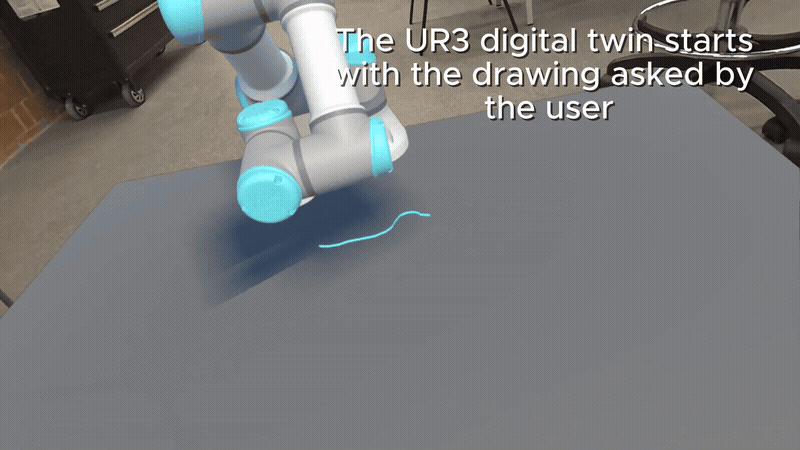
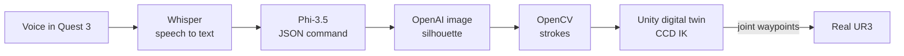

# Voice-Controlled VR Drawing Robot

Speak inside a Meta Quest 3, and a real UR3 robot arm draws what you said.



DEMO_VIDEO_HERE

## How it works

1. **Voice.** In the headset, the user records a request on the voice panel. The app sends it as a WAV file to a PC server.
2. **Text.** Whisper large-v3-turbo transcribes the Spanish audio.
3. **Command.** A local LLM (Phi-3.5 on Ollama) turns the sentence into strict JSON: up to two subjects, one of nine layouts ("a cat next to a dog" → `left_right`), and a short reply shown in VR.
4. **Image.** OpenAI's image model generates a flat black silhouette of the subjects, a form that is easy to trace.
5. **Strokes.** OpenCV extracts the outline. The server publishes it as strokes of normalized (u, v) points.
6. **Simulation.** The Quest app polls the server and draws the strokes on a Unity digital twin of the UR3, standing on a table in passthrough.
7. **Real robot.** The joint angles recorded during the simulation are sent to the physical UR3, which repeats the same motion with a marker.



## Engineering challenges

- **Moving the real arm safely.** Cartesian moves on the real UR3 can pass through singularities near the edge of the board. Instead, the IK is solved once in the digital twin and the real arm receives joint-space waypoints, sampled every 0.2 s. The controller only interpolates joints. The twin and the real UR3 use different joint zeros and directions, so I calibrated a sim-to-real mapping and kept it in one place (`UR3AngleMapper.cs`).
- **Inverse kinematics.** I wrote a Cyclic Coordinate Descent solver for the UR3 with joint limits and two phases. The shoulder and elbow joints place the pen, then the wrist joints keep it perpendicular to the board. Before each stroke, the solver runs 80 iterations to find a stable approach pose. The arm reaches that pose with a joint-space move (MoveJ), traces the stroke with IK active, and lifts the pen 4 cm before the next one.
- **Turning images into drawable strokes.** Generated images usually carry shading that becomes noisy strokes. I constrained generation to flat silhouettes and kept only the outer contour. In Unity, long segments are resampled to at most 2 cm so the IK never has to make a large jump.
- **Unreliable LLM output.** A small local model does not always return valid JSON, and it treats "hello" as a drawing request. A strict prompt with a fixed set of layouts handles the second problem. A parser that falls back from direct parsing to regex extraction to closing truncated JSON handles the first. A 24-case test suite checks every field and measures latency.

<!--
  Add this back if it is visible in the code or scenes, so a reviewer can find it:
- **Meta ISDK canvas registration.** <describe the bug and the fix>
-->

## VR app

Built with Unity and the Meta XR SDK (Interaction SDK, passthrough). Main menu, an optional onboarding tutorial, a voice panel with live audio waveform, guided dialogue during each stage, a decision panel when the drawing finishes, and a Home button that resets the robot and the scene.

## Tech stack

- **VR and simulation:** Unity 2022.3 (URP), Meta XR SDK 201, Meta Quest 3, C#
- **Speech:** Whisper large-v3-turbo (Hugging Face Transformers, PyTorch)
- **Language:** Phi-3.5 via Ollama
- **Image generation:** OpenAI Images API
- **Stroke extraction:** OpenCV, NumPy
- **Robot:** Universal Robots UR3 (CB3), HTTP bridge to a Flask server

## My role
I designed and built the full VR experience (UI/UX and the Meta Quest 3 adaptation in Unity), built along with the team the AI pipeline end to end (choosing and chaining Whisper, Llama, Gemma and OpenAI models, and handling their voice, text and image inputs and outputs), and connected it all to the robot side, so the real UR3 reproduced what the Unity digital twin planned.

**Team:** : Diego Márquez, Antonio Reyes y Haili Ávila

## Repository layout

| Path | Contents |
| --- | --- |
| `unity/` | Quest app and UR3 digital twin. Main scene: `Assets/Scenes/micro.unity` |
| `unity/Assets/Scripts/UR3/` | `CCDIKSolver`, `StrokeDrawer`, `TrajectoryReceiver`, `UR3DirectSender`, `UR3AngleMapper` |
| `bloque1_stt/` | Whisper speech-to-text service |
| `bloque2_llm/` | LLM prompt, JSON parser, and test suite |
| `bloque3_imagen/` | Image generation and contour extraction, with sample output |

The PC server that connects steps 1–5 and the Flask bridge to the UR3 are not in this repository yet.

## Run it

**Quest app:** open `unity/` in Unity 2022.3.58f1, set the server and robot IPs in `Assets/Scripts/UR3/NetworkConfig.cs`, open `Assets/Scenes/micro.unity`, and build for Android to a Quest 3.

**Python modules** (Python 3.10+):

```bash
pip install torch transformers accelerate requests opencv-python numpy python-dotenv openai
```

Language test (needs [Ollama](https://ollama.com) running):

```bash
ollama pull phi3.5
python bloque2_llm/test_phi35.py
```

Image → strokes (put `OPENAI_API_KEY=...` in `bloque3_imagen/openai.env`, which is git-ignored):

```bash
cd bloque3_imagen && python generacion_imagen.py
```
