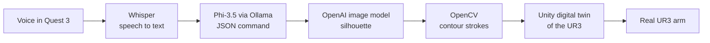

# Voice-Controlled VR Drawing Robot

Speak inside a Meta Quest 3, and a real UR3 robot arm draws what you said.


DEMO_VIDEO_HERE

## How it works

1. **Voice → text.** The headset records a spoken request in Spanish. Whisper large-v3-turbo transcribes it, on GPU when one is available.
2. **Text → drawing command.** A local LLM (Phi-3.5, served by Ollama) turns the sentence into strict JSON: up to two subjects as English nouns, one of nine layouts ("a cat next to a dog" → `left_right`), and a short reply shown to the user in VR. Greetings and off-topic requests return `unknown` with examples of valid requests.
3. **Command → image.** The subjects go into a prompt for OpenAI's image model, which is constrained to a flat black silhouette on a white background so the result is easy to trace.
4. **Image → strokes.** OpenCV binarizes the silhouette (Otsu threshold) and extracts its outer contour with `findContours`, giving the path the pen will follow.
5. **Simulation.** The drawing runs first on a Unity digital twin of the UR3.
6. **Real robot.** The same trajectory is sent to the physical UR3, which draws it on the board.



## Engineering challenges

- **Unreliable LLM output.** A small local model does not always return valid JSON, invents layouts, or treats "hello" as a drawing request. I wrote a strict system prompt with a closed set of layouts and worked examples, and a parser that falls back from direct parsing, to regex extraction, to closing truncated JSON. A 24-case test suite (single objects, spatial relations, vague requests, non-drawing input) checks every field and reports latency.
- **Images a robot can actually draw.** Generated images usually carry shading and texture that turn into noisy, unusable strokes. I constrained generation to flat silhouettes, with a separate prompt for multi-object scenes, then kept only the external contour so the arm traces one clean outline per shape.
- **Open requests.** Users say things like "surprise me" or "what can you draw?". Instead of failing, the model picks a simple drawable subject and confirms it in the headset, so every session ends with something on the board.

<!--
  The bullets below describe parts that are not in this repository yet
  (Unity project, IK solver, ISDK panels). Uncomment them once that code is pushed,
  so a reviewer can find it.

- **Singularities near the workspace edge.** Cartesian interpolation drove the UR3 through wrist and elbow singularities near the limits of the board. I moved the arm in joint space (MoveJ) instead.
- **Inverse kinematics.** I wrote a custom IK solver for the UR3 (CB3) from its DH parameters, used by the Unity digital twin.
- **Meta ISDK canvas registration.** <describe the bug and the fix>
-->

## Tech stack

- **Speech:** Whisper large-v3-turbo (Hugging Face Transformers, PyTorch)
- **Language:** Phi-3.5 via Ollama
- **Image generation:** OpenAI Images API
- **Stroke extraction:** OpenCV, NumPy
- **VR and simulation:** Unity, Meta Quest 3, Meta Interaction SDK
- **Robot:** Universal Robots UR3 (CB3)

## My role

_TODO: describe what you built._

**Team:** _TODO: names, or delete this line._

## Repository layout

| Folder | Contents |
| --- | --- |
| `bloque1_stt/` | `TranscriptionService`: Whisper speech-to-text |
| `bloque2_llm/` | LLM prompt, JSON parser, and test suite |
| `bloque3_imagen/` | Image generation and contour extraction, with sample output (`1_silueta_ia.png` → `2_trazo_robot.png`) |

The Unity VR app and the robot control code are not in this repository.

## Run it

Requires Python 3.10+.

```bash
pip install torch transformers accelerate requests opencv-python numpy python-dotenv openai
```

**Language test** (needs [Ollama](https://ollama.com) running locally):

```bash
ollama pull phi3.5
python bloque2_llm/test_phi35.py
```

**Image → strokes** (put `OPENAI_API_KEY=...` in `bloque3_imagen/openai.env`):

```bash
cd bloque3_imagen && python generacion_imagen.py
```

**Speech to text:**

```python
from bloque1_stt.pepe import TranscriptionService
print(TranscriptionService().transcribir_audio("audio.wav"))
```
